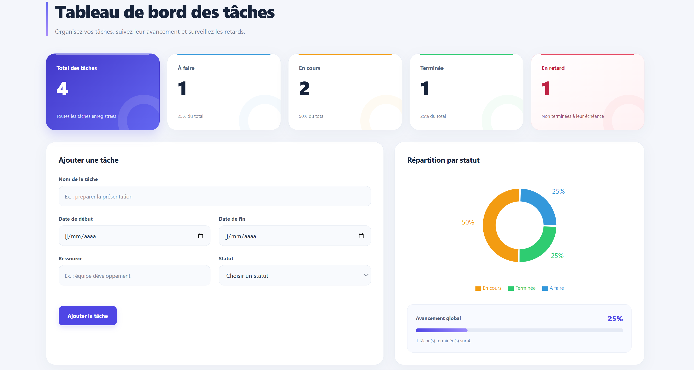

# Task Manager Dashboard

A responsive React application for organizing daily work and tracking
task progress through a visual dashboard.

Create and manage tasks, monitor status-based KPIs, and quickly identify
overdue work. Tasks are saved automatically in your browser using
localStorage, so your list remains available after refreshing the page.

## Features

- **Task management:** Create, edit, and delete tasks.
- **Task details:** Set a title, start date, due date, resource, and status.
- **Status tracking:** Organize tasks as To Do, In Progress, or Done.
- **Automatic saving:** Keep tasks after refreshing or reopening the browser using localStorage.
- **Dashboard KPIs:** View the total number of tasks and counts by status.
- **Overdue tracking:** Highlight overdue tasks in red and display a dedicated counter.
- **Interactive chart:** Explore task distribution through a doughnut chart.
- **Completion progress:** View the percentage of completed tasks.
- **Responsive layout:** Use the dashboard on desktop, tablet, and mobile screens.

## Tech Stack

| Technology | Purpose |
|------------|---------|
| React | Components and user interface |
| JavaScript | Task management and dashboard calculations |
| CSS | Styling and responsive layouts |
| Recharts | Task distribution chart |
| localStorage | Browser-based persistence |

## Getting Started

### Prerequisites

- Node.js and npm
- Git

### Installation

1. Clone your repository:

   ```bash
git clone https://github.com/meryembouaddi/react-task-dashboard.git
   ```

2. Open the project directory:

   ```bash
cd react-task-dashboard
   ```

3. Install dependencies:

   ```bash
   npm install
   ```

4. Check the available scripts:

   ```bash
   npm run
   ```

   Start the application using the development script defined in
   `package.json`. For example, use `npm run dev` if the project uses
   Vite, or `npm start` if it uses Create React App.

5. Open the local address displayed in your terminal.
## Preview



## How to Use

1. Enter a task title.
2. Optionally provide a start date, due date, and resource.
3. Select a status.
4. Click the add button to save the task.
5. Use the edit and delete buttons to manage existing tasks.

The dashboard indicators and chart update automatically when tasks change.

The current interface uses French labels:
**À faire**, **En cours**, and **Terminée**.

## Overdue Task Rules

A task is considered overdue when:

- It has a due date.
- Its due date is earlier than the current local date.
- Its status is not Done.

A task due today becomes overdue the following day.
Tasks without a due date are not considered overdue.

The overdue counter overlaps with To Do and In Progress counts.
It is an additional indicator, not a separate task status.

## Completion Rate

The completion rate is calculated as:

```text
Completion rate = (Completed tasks / Total tasks) × 100
```

The dashboard displays 0% when no tasks exist.

## Data Persistence

Tasks are stored as JSON in localStorage under the key:

```text
taskmanager-taches
```

Saved tasks are loaded when the component initializes.
Additions, edits, and deletions are saved automatically.

Data is specific to the browser profile and site origin. It is not
synchronized between devices, and clearing the site's browser data
removes saved tasks.

This application does not require a backend or database.

## Manual Verification

- Create a task and refresh the page: the task should remain.
- Edit a task and refresh: the updated values should remain.
- Delete a task and refresh: it should not reappear.
- Create an unfinished task with yesterday's due date:
  it should appear in red and increase the overdue counter.
- Mark that task as Done:
  it should leave the overdue count and increase the completion rate.
- Check the layout on a narrow screen.

## Possible Future Improvements

- Search tasks by title.
- Filter tasks by status or overdue state.
- Add task priorities.
- Export and import tasks.
- Add user authentication and cloud synchronization.
